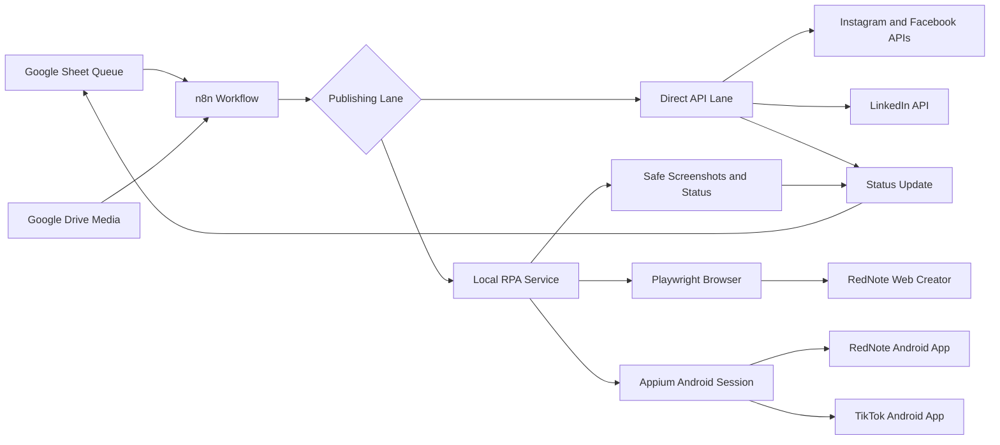
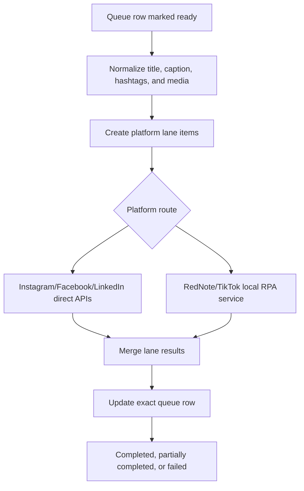
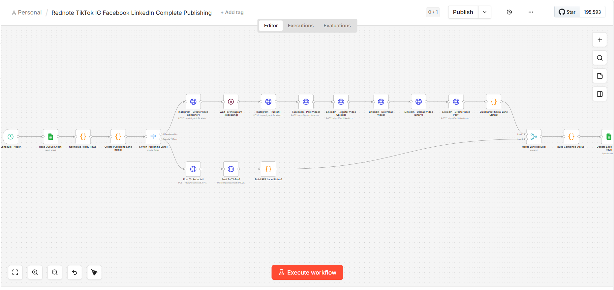

# RedNote Autoposting with n8n

> [!NOTE]
> This repository is a sanitized engineering case study. It explains the architecture, workflows, safety boundaries, and engineering decisions behind a RedNote/Xiaohongshu social publishing automation system without exposing secrets, account sessions, credentials, private workflow exports, or downloaded media.

## Hero Overview

**RedNote Autoposting with n8n** is a safe, attended multi-platform publishing automation system. It uses n8n to orchestrate content queues, Google Sheets and Drive for lightweight operations, a local Node.js RPA service for publishing adapters, Playwright for attended web automation, and Appium/WebdriverIO for mobile automation.

The project solves a practical content operations problem: teams need repeatable publishing across RedNote, TikTok, Instagram, Facebook, and LinkedIn without manually copying captions, downloading media, switching apps, and tracking statuses by hand.

<strong>Portfolio Snapshot</strong>

| Dimension | Summary |
| --- | --- |
| Product | Multi-platform content publishing automation |
| Orchestrator | n8n workflows |
| Queue | Google Sheets with Drive media links |
| Local Service | Node.js and Express RPA API |
| Web Automation | Playwright attended browser lane |
| Mobile Automation | Appium and WebdriverIO Android lane |
| Platforms | RedNote/Xiaohongshu, TikTok, Instagram, Facebook, LinkedIn |
| Safety Model | Human approval and confirmation by default |

## Project Summary

The system processes one approved queue row at a time, normalizes media, routes each platform through the correct publishing lane, posts through direct APIs where available, and uses attended RPA where official publishing APIs are unavailable or impractical.

The design is intentionally not a stealth bot. It stops for login, CAPTCHA, SMS/2FA, account warnings, UI mismatches, disabled publish buttons, or final human review.

## Feature Highlights

| Area | Capability | Why It Matters |
| --- | --- | --- |
| n8n orchestration | Queue polling, media normalization, lane routing, status sync | Keeps the workflow understandable and maintainable |
| Google Sheets queue | Lightweight content operations console | Lets non-engineers manage publishing rows |
| Direct API lanes | Instagram, Facebook, and LinkedIn branches | Uses official APIs where practical |
| RPA lanes | RedNote and TikTok mobile/web publishing | Handles platforms without straightforward public publishing APIs |
| Safety stops | Login/CAPTCHA/2FA/account-warning detection | Keeps automation compliant and operator-controlled |
| Status tracking | Per-platform messages and completion state | Makes partial success and recovery visible |

## Technology Stack

| Layer | Technologies |
| --- | --- |
| Orchestration | n8n, workflow JSONs, HTTP request nodes, switches, merges |
| Queue and assets | Google Sheets, Google Drive links, local media download path |
| Local API | Node.js, Express, Zod validation |
| Browser RPA | Playwright with persistent operator-owned browser profile |
| Mobile RPA | Appium, WebdriverIO, Android device or emulator |
| Direct publishing | Meta and LinkedIn API lanes |
| Operations | PowerShell helper scripts, runbooks, screenshot artifacts |

## Architecture Preview

[Read the full architecture](docs/03-system-architecture.md)

## Workflow Preview

[Read the n8n workflow](docs/04-n8n-workflow.md)

## Screenshot Gallery

Screenshots are captured with demo workflow data and selected to show the system from orchestration through local automation.

| n8n Orchestration | Queue Control |
| --- | --- |
|  |  |
| The workflow routes content across direct API and RPA lanes. | A spreadsheet queue gives operators a lightweight control surface. |

| Local RPA API | Mobile Automation Runtime |
| --- | --- |
|  |  |
| The local service bridges n8n HTTP requests to attended publishing adapters. | Appium provides the mobile automation lane for Android publishing workflows. |

<strong>Remaining Screenshot Targets</strong>

| Screenshot | Purpose |
| --- | --- |
| `workflow-lane-routing.png` | Close-up of the direct API vs RPA routing branch |
| `rednote-mobile-draft.png` | RedNote draft state with demo content |
| `tiktok-mobile-publish.png` | TikTok mobile publishing state with demo content |
| `status-sheet.png` | Publishing results written back to operations sheet |
| `artifacts-folder.png` | Sanitized artifact and screenshot outputs |
| `runbook.png` | Safety runbook or checklist view |

[View screenshot capture plan](screenshots/README.md)

## Documentation Navigation

| Document | What It Explains |
| --- | --- |
| [01 Executive Summary](docs/01-executive-summary.md) | Portfolio-level summary and technical value |
| [02 Business Problem](docs/02-business-problem.md) | Why multi-platform publishing automation matters |
| [03 System Architecture](docs/03-system-architecture.md) | Components, boundaries, and data flow |
| [04 n8n Workflow](docs/04-n8n-workflow.md) | Queue processing and platform lane orchestration |
| [05 RPA Service](docs/05-rpa-service.md) | Local API, validation, job status, safety behavior |
| [06 Mobile Automation](docs/06-mobile-automation.md) | Appium/WebdriverIO mobile publishing lane |
| [07 Data Model](docs/07-data-model.md) | Accounts, content, assets, jobs, and logs |
| [08 API Overview](docs/08-api-overview.md) | Behavior-level service endpoint documentation |
| [09 Feature Documentation](docs/09-feature-documentation.md) | Features by operator workflow |
| [10 Engineering Decisions](docs/10-engineering-decisions.md) | Trade-offs and architectural reasoning |
| [11 Challenges](docs/11-challenges.md) | Platform fragility, safety, sync, and reliability |
| [12 My Contributions](docs/12-my-contributions.md) | Contribution narrative for portfolio reviewers |
| [13 Future Improvements](docs/13-future-improvements.md) | Roadmap for production hardening |
| [Appendix](docs/appendix.md) | Glossary, safety checklist, review notes |
| [Diagram Plan](diagrams/README.md) | Editable Mermaid diagram inventory |
| [Screenshot Plan](screenshots/README.md) | Capture list and privacy guidance |

## Key Achievements

- Designed a safe publishing architecture around n8n orchestration and attended RPA.
- Created adapter routing for manual packs, web RPA, mobile RPA, direct APIs, and future approved tools.
- Integrated Google Sheets and Drive as a lightweight content operations layer.
- Built local Node.js publishing endpoints with schema validation and job status tracking.
- Added Android automation for mobile-only publishing flows using Appium/WebdriverIO.
- Defined explicit safety boundaries for login, CAPTCHA, 2FA, account warnings, and final confirmation.

## Lessons Learned

> [!IMPORTANT]
> Social automation is less about clicking faster and more about controlling risk. The strongest architecture keeps orchestration, approval, publishing adapters, and human intervention states separate.

- Use official APIs where they exist; use attended RPA only where platform constraints require it.
- A queue-first workflow makes partial failures visible and recoverable.
- Mobile automation should be serialized because one Android device can only handle one publishing session cleanly.
- Human confirmation is a product safety feature, not an inconvenience.
- Portfolio documentation should explain the safety model as clearly as the technical workflow.
