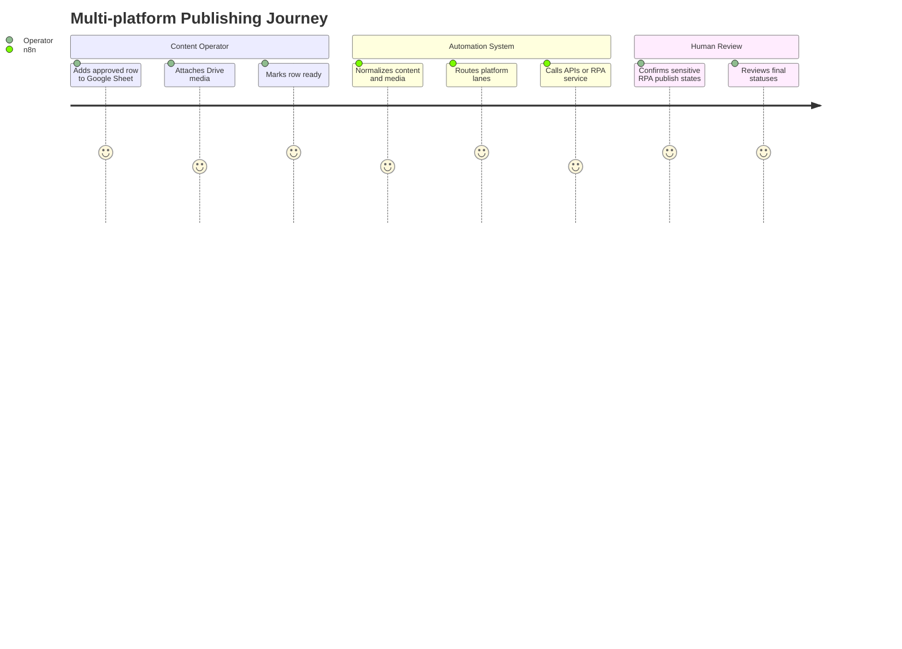
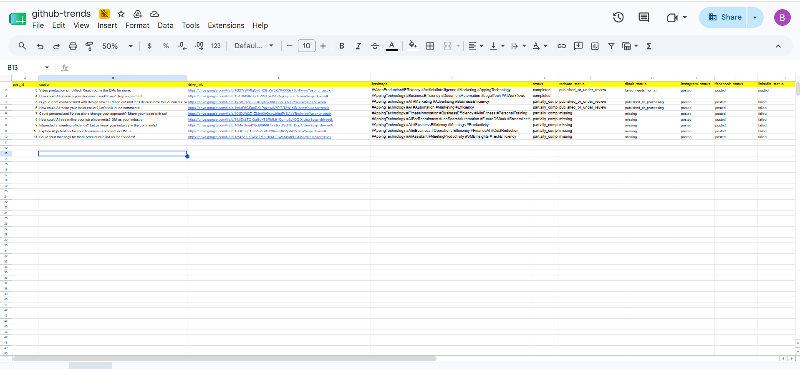

[Back to README](../README.md)

# 02 Business Problem

## Problem

Creators, agencies, and small marketing teams need to publish the same campaign across multiple channels. Manual posting is repetitive, slow, and easy to mis-track. Full automation is tempting, but social platforms introduce login challenges, UI changes, media constraints, and account safety concerns.

## Stakeholders

| Stakeholder | Need |
| --- | --- |
| Content operator | Prepare and publish posts without repetitive copy/paste work |
| Marketing lead | See which platforms succeeded, failed, or need attention |
| Automation engineer | Keep workflow logic maintainable and recoverable |
| Account owner | Avoid risky stealth automation and preserve account trust |

## Success Criteria

- One queue row can drive publishing across several platforms.
- Direct APIs handle platforms where supported.
- RPA handles platforms where API access is limited.
- Human intervention states are explicit and visible.
- Status updates return to the original row for operational tracking.

## User Journey

## Screenshot

The queue sheet demonstrates the lightweight operations interface used to coordinate multi-platform publishing.
