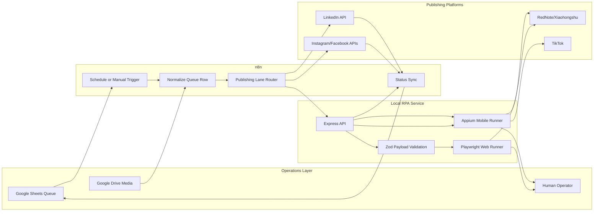

[Back to README](../README.md)

# 03 System Architecture

## Architecture Summary

The architecture separates orchestration from publishing adapters. n8n owns workflow coordination, while the local Node.js service exposes narrow RPA endpoints that can be called from workflow HTTP nodes.

## Component Responsibilities

| Component | Responsibility |
| --- | --- |
| Google Sheets | Queue, statuses, platform result messages |
| Google Drive | Source media files |
| n8n | Routing, scheduling, API calls, merge results, row updates |
| Node RPA service | Validates jobs and invokes browser/mobile automation |
| Playwright | Attended browser automation for web publishing |
| Appium/WebdriverIO | Android automation for RedNote and TikTok mobile apps |
| Operator | Handles login, CAPTCHA, 2FA, warnings, and final publish review |
