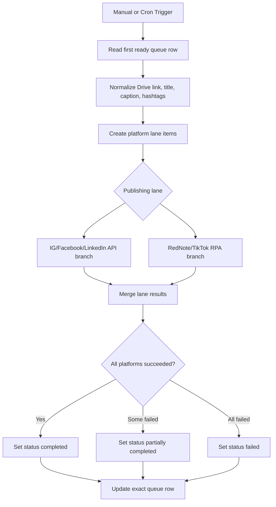

[Back to README](../README.md)

# 04 n8n Workflow

## Workflow Summary

n8n is the orchestration layer. It reads approved queue rows, normalizes content and media, creates platform-specific lane items, calls the correct publishing adapter, merges results, and updates the original queue row.

## Combined Workflow

## Workflow Design Choices

| Choice | Reason |
| --- | --- |
| Process first ready row only | Prevents one phone/Appium session from receiving concurrent jobs |
| Exact row update | Avoids overwriting the wrong content item |
| Per-platform status fields | Makes partial success visible |
| Direct API and RPA split | Uses the most stable lane available for each platform |

## Screenshot

The full workflow screenshot shows how a single queue row can fan out into direct API and RPA publishing lanes before merging status results.
