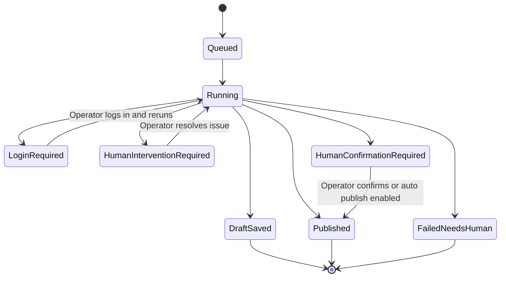

[Back to README](../README.md)

# 05 RPA Service

## Service Summary

The RPA service is a local Node.js/Express API that n8n calls when a platform requires attended browser or mobile automation. It validates payloads, starts the correct runner, stores in-memory job status, and returns a structured result.

## Responsibilities

| Responsibility | Purpose |
| --- | --- |
| Payload validation | Reject malformed publish jobs before automation starts |
| Adapter selection | Route RedNote web, RedNote mobile, or TikTok mobile jobs |
| Human stop states | Return clear statuses for login, CAPTCHA, 2FA, UI mismatch, and confirmation |
| Job status lookup | Let n8n poll job status when needed |
| Metadata echo | Return content identifiers and platform context for status sync |

## RPA State Machine

## Screenshot

The local service provides the HTTP bridge between n8n and attended publishing adapters.
