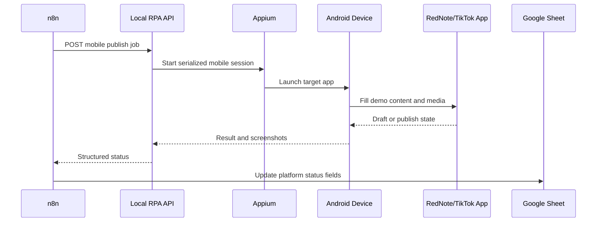
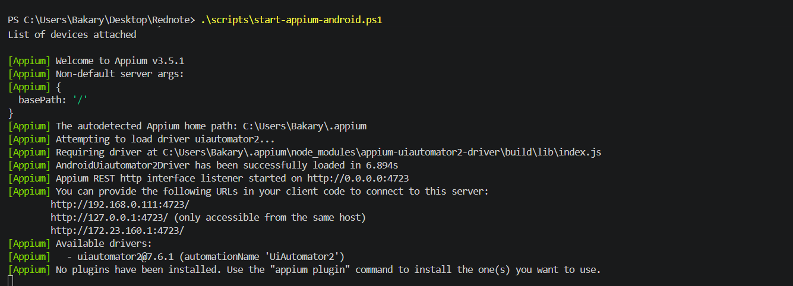

[Back to README](../README.md)

# 06 Mobile Automation

## Mobile Lane Summary

The mobile automation lane uses Appium and WebdriverIO to control an Android device or emulator. It exists because some publishing experiences are more stable or only accessible through mobile apps.

## Flow

## Safety Notes

- Mobile automation runs one job at a time.
- Login and security prompts are handled by the operator.
- Final publish can remain manual until the workflow is stable.
- Selector calibration is expected because mobile UI changes over time.

## Screenshot

The Appium runtime enables the Android publishing lane for mobile-first platform workflows.
