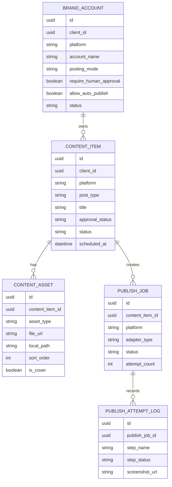

[Back to README](../README.md)

# 07 Data Model

## Data Model Summary

The project models accounts, content items, assets, publish jobs, and publish attempt logs. Google Sheets can act as a lightweight operational surface, while a database-backed model provides the path toward production reliability.

## ER Diagram

## Status Concepts

| Status Area | Purpose |
| --- | --- |
| Content status | Tracks draft, scheduled, completed, partially completed, or failed workflow state |
| Approval status | Separates content approval from publishing execution |
| Publish job status | Tracks adapter execution outcome |
| Attempt logs | Captures step-level traceability and screenshots |

## Screenshot Placeholder

**File:** `screenshots/status-sheet.png`

Capture the status sheet with demo results and no real platform account information.

