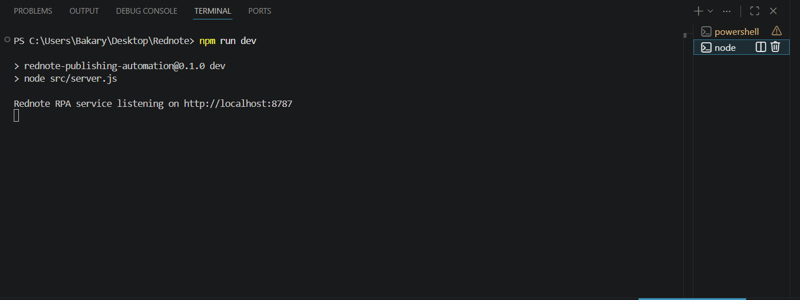

[Back to README](../README.md)

# 08 API Overview

## API Summary

The local API exposes a small surface area designed for n8n HTTP Request nodes. The API is not a public SaaS API; it is a local automation adapter for approved workflow jobs.

> [!CAUTION]
> This page documents endpoint behavior only. It does not include secrets, credentials, raw workflow exports, or private account/session data.

## Endpoints

| Endpoint | Method | Purpose |
| --- | --- | --- |
| `/health` | GET | Confirms the local RPA service is running |
| `/publish-jobs` | POST | Starts an attended RedNote web publishing job |
| `/mobile-publish-jobs` | POST | Starts a serialized RedNote mobile publishing job |
| `/tiktok-mobile-publish-jobs` | POST | Starts a serialized TikTok mobile publishing job |
| `/publish-jobs/:jobId` | GET | Returns the latest known job status |

## Request Contract

Publishing jobs include a job ID, content item ID, post type, title, caption, hashtags, optional location, assets, scheduling metadata, and safety flags such as final publish behavior.

## Response Contract

Responses return a job ID, status, message, screenshot references where available, and enough content metadata for n8n to update the source row.

## Screenshot

The local API surface is intentionally small: n8n sends validated publishing jobs and receives structured statuses.
