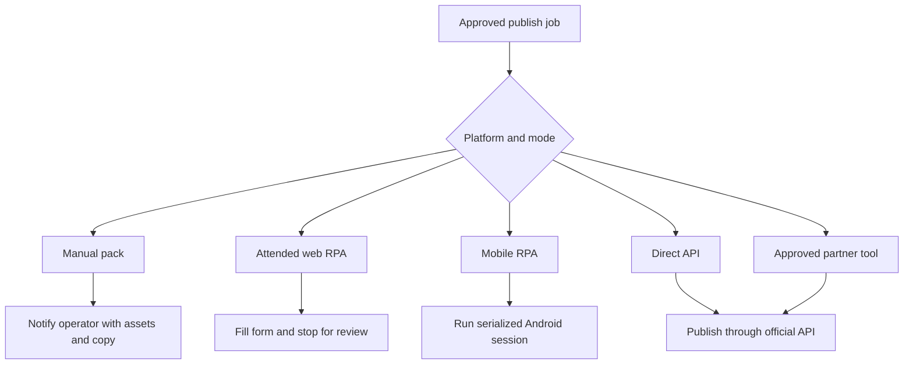

[Back to README](../README.md)

# 10 Engineering Decisions

## Decision Summary

The architecture favors safe, visible automation over fragile full autopublishing. The system uses APIs where available, RPA where necessary, and human confirmation where account risk or platform uncertainty is high.

## Key Trade-offs

| Decision | Trade-off | Outcome |
| --- | --- | --- |
| n8n orchestration | Less custom code, more workflow discipline | Faster iteration and visible operations |
| Google Sheets queue | Simple and accessible, less robust than a database | Useful lightweight control surface |
| Adapter routing | More branches, better platform fit | APIs and RPA can coexist safely |
| Attended RPA | Slower than stealth automation, safer for accounts | Login and security prompts remain human-owned |
| Mobile serialization | Lower throughput, higher stability | Avoids concurrent Appium/device conflicts |
| Human final review | Less hands-off, better compliance | Reduces accidental or risky publishing |

## Adapter Routing

## Screenshot

The n8n canvas shows the adapter decision in practice: direct API platforms and RPA platforms run in separate lanes.
