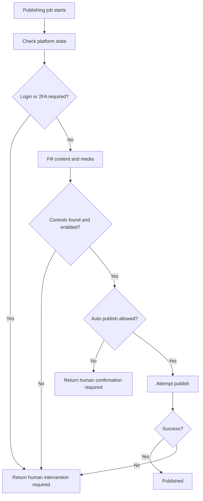

[Back to README](../README.md)

# 11 Challenges

## Challenge Summary

The hardest part of this project is not making a browser or phone click. The hard part is designing automation that survives platform instability, respects account security, and leaves operators with enough visibility to recover from partial failure.

## Challenge Matrix

| Challenge | Risk | Mitigation |
| --- | --- | --- |
| Platform UI changes | RPA selectors break | Keep selectors isolated and use runbooks for calibration |
| CAPTCHA/2FA/login prompts | Unsafe bypass temptation | Stop and require human intervention |
| Mobile device concurrency | Appium conflicts or session corruption | Process one mobile RPA job at a time |
| Media download issues | Failed posts or wrong asset | Normalize Drive links and return failure messages |
| Partial platform success | Operators lose track | Per-platform status and messages |
| Credential exposure | Account compromise | Never export credentials or session profiles into portfolio docs |
| API/RPA mismatch | Workflow complexity | Adapter routing with clear responsibilities |

## Failure Flow

