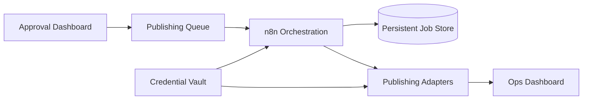

[Back to README](../README.md)

# 13 Future Improvements

## Roadmap Summary

Future work should focus on durability, observability, richer approvals, credential safety, and official publishing integrations where available.

## Recommended Improvements

| Area | Improvement | Benefit |
| --- | --- | --- |
| Approval UX | Build a small approval dashboard | Reduces reliance on spreadsheet-only review |
| Persistent jobs | Store job state in Postgres/Supabase | Survives service restarts |
| Retry policy | Add controlled retry and backoff | Improves recoverability without spamming platforms |
| Observability | Add dashboard for statuses, errors, and screenshots | Makes operations easier to monitor |
| Credential vaulting | Move secrets into managed credential storage | Reduces local secret risk |
| Official APIs | Add approved platform APIs where available | Reduces dependence on RPA |
| Test fixtures | Add sanitized workflow test payloads | Improves regression confidence |

## Future Architecture

